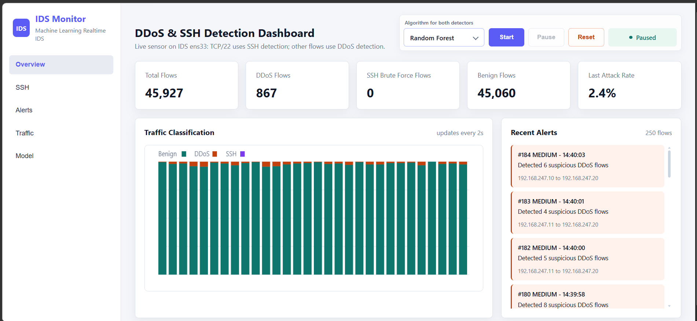
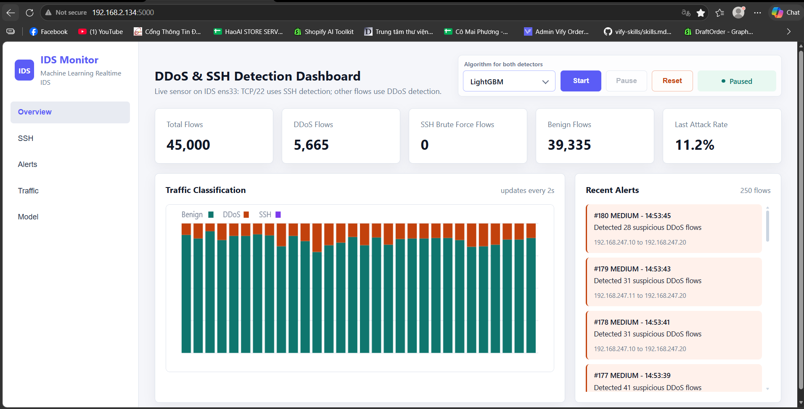
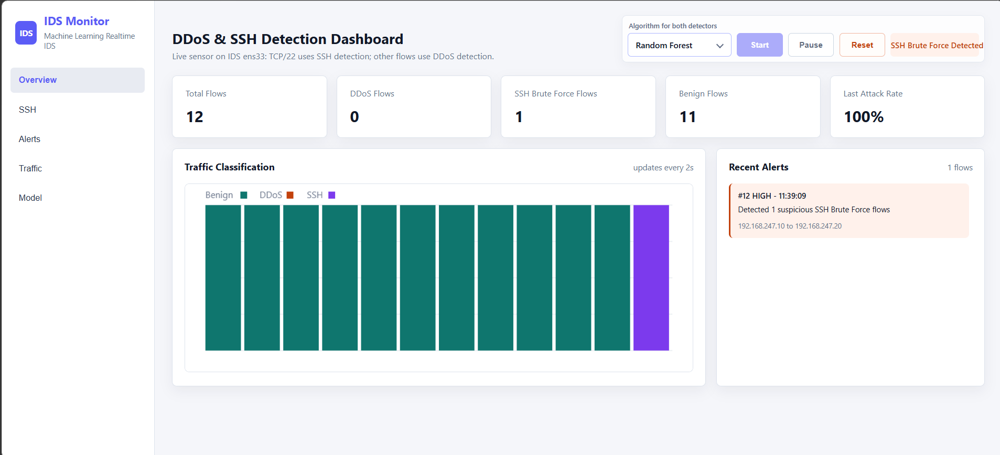
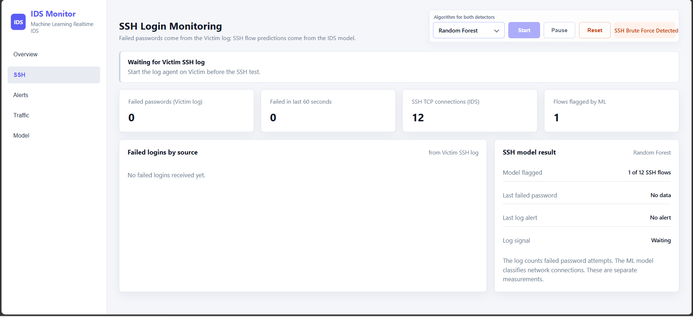
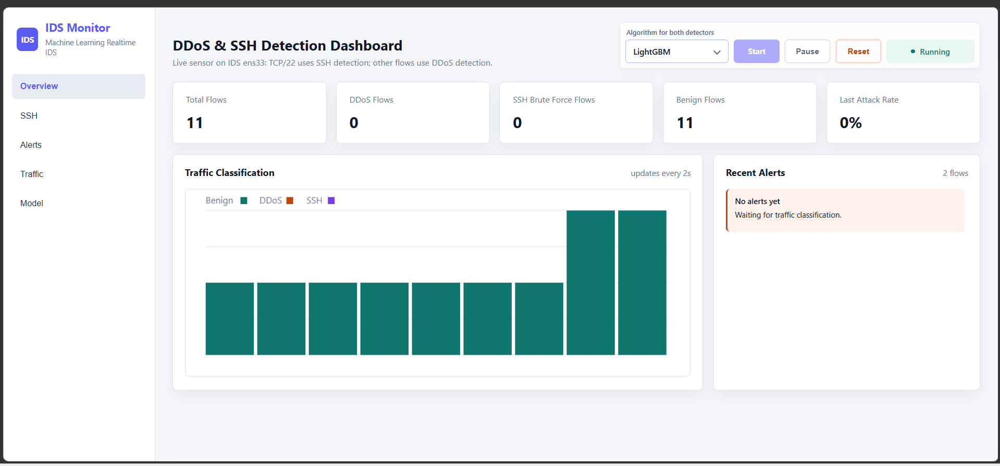
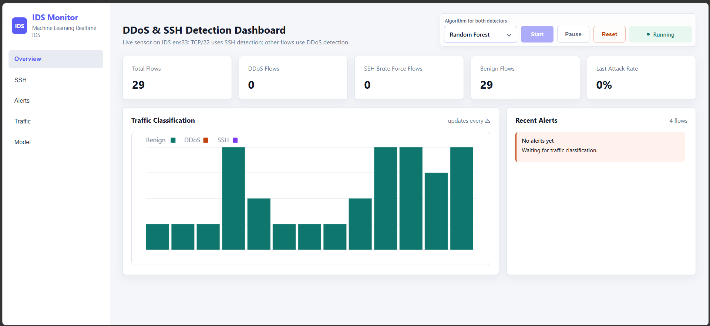

# Biên bản demo IDS cuối trước giai đoạn viết báo cáo — DDoS 27/10, SSH 02/11/2026

> Trạng thái: đã ghi hai ảnh DDoS ngày 27/10 và ba ảnh SSH ngày 02/11/2026. Đường gửi log từ Victim trong phiên SSH cuối còn cần kiểm tra. Các số dưới đây là số hiển thị trên dashboard, không phải nhãn đúng của từng flow.

## 1. Mục đích và phạm vi

Buổi này là lần chạy demo cuối của hệ thống IDS trong mạng máy ảo trước khi chuyển trọng tâm sang viết báo cáo đồ án. Hai kịch bản cần ghi nhận riêng là **HTTP flood từ Kali và Bot** và **thử mật khẩu SSH từ Kali**. Mục đích là xác nhận chương trình chạy với lưu lượng thật trong lab, ghi lại số liệu và cảnh báo thực tế, đồng thời nêu các giới hạn còn tồn tại. Không coi một buổi demo là phép đo khả năng hoạt động trên Internet hoặc tỷ lệ phát hiện tổng quát.

## 2. Sơ đồ và cách hệ thống hoạt động

| Máy | Địa chỉ trong lab | Vai trò |
| --- | --- | --- |
| Kali | `192.168.247.10` | Tạo HTTP flood; riêng bài SSH dùng Hydra |
| Bot | `192.168.247.11` | Nguồn HTTP flood thứ hai do Kali điều khiển |
| Victim | `192.168.247.20` | Apache2 cổng 80 và SSH cổng 22 |
| IDS | `192.168.247.30` | Sensor `ens33`, suy luận model, lưu log và dashboard |

Sensor `src/live_sensor.py` bắt gói giữa các nguồn đã khai báo và Victim, gom thành flow rồi ghi `data/live_flows.csv`. Detector `src/realtime_detect.py` đưa TCP đích cổng 22 sang model SSH; các flow còn lại sang model DDoS. Dropdown trên dashboard chọn Random Forest hoặc LightGBM cho cả hai nhánh, nhưng mỗi nhánh dùng model đã huấn luyện riêng. Dashboard đọc các kết quả đã lưu và hiển thị tổng flow, số flow được phân loại, lịch sử và cảnh báo.

## 3. Kịch bản HTTP flood/DDoS

Trên Kali chạy `bash /home/kali/attack_http_flood.sh --with-bot`. Script điều khiển cả Kali và Bot gửi HTTP request tới Apache2 trên Victim. Cấu hình mặc định của mỗi máy là tối đa **180 giây**, **2.000 request mỗi vòng**, **50 kết nối đồng thời** và nghỉ **2 giây** giữa các vòng. `Ctrl+C` ở Kali dừng phiên trên cả hai máy. Đây là bài **HTTP flood hai nguồn trong lab**; nó minh họa đặc điểm nhiều nguồn của DDoS, không phải botnet thật hoặc phép thử khả năng chịu tải Internet của Victim.

Model DDoS dự đoán từng **flow** dựa trên 46 đặc trưng. IP nguồn và cổng đích được dùng để định tuyến/hiển thị, không phải số lượng máy tham gia được đưa trực tiếp vào dự đoán. Vì vậy tăng số nguồn không tự bảo đảm tỷ lệ phát hiện tăng hoặc giống lần demo này. Nếu model đánh dấu ít nhất một flow DDoS trong một lô, dashboard ghi cảnh báo cho lô đó; mức `HIGH` khi ít nhất 70% flow trong lô/nhánh đó bị đánh dấu, còn có dương tính nhưng dưới ngưỡng này là `MEDIUM`. Đây là mức cảnh báo theo **tỷ lệ dự đoán trong lô**, không phải đánh giá chắc chắn rằng Victim đã mất khả năng phục vụ.

`DDoS Flows` là số flow được model dự đoán là DDoS. `Benign Flows` là số flow được dự đoán bình thường. `Last Attack Rate` = số flow được dự đoán tấn công chia cho tổng flow **của lô/nhánh xử lý mới nhất**; nó không phải tỷ lệ HTTP request độc hại, cũng không phải tỷ lệ cả buổi. Sau khi flood dừng, `Last Attack Rate` có thể về 0% trong khi tổng `DDoS Flows` vẫn giữ nguyên.

### Kết quả thực tế của phiên cuối

Hai ảnh đều chụp dashboard ở trạng thái `Paused`. Ảnh không cho biết số request Apache nhận thành công, thời điểm bắt đầu/dừng script, hoặc các flow có được gán nhãn đúng độc lập hay không. Số tổng trên dashboard có thể là cộng dồn trong từng phiên kể từ lần reset tương ứng; ảnh không đủ để xác nhận hai model được chạy trên cùng một tập flow.

| Chỉ số trên dashboard | Random Forest | LightGBM |
| --- | ---: | ---: |
| Tổng flow | 45.927 | 45.000 |
| Flow **được model dự đoán** DDoS | 867 | 5.665 |
| Flow **được model dự đoán** benign | 45.060 | 39.335 |
| Flow **được model dự đoán** SSH Brute Force | 0 | 0 |
| Tỷ lệ flow dự đoán DDoS trên toàn bộ flow đang hiển thị, tự tính | 1,89% | 12,59% |
| `Last Attack Rate` **của lô gần nhất** | 2,4% | 11,2% |
| Cảnh báo nhìn thấy | `MEDIUM`, ví dụ lô #184 lúc 14:40:03: 6 flow | `MEDIUM`, ví dụ lô #180 lúc 14:53:45: 28 flow |

Danh sách cảnh báo trong cả hai ảnh có nguồn `192.168.247.10` **và** `192.168.247.11` đi tới `192.168.247.20`, phù hợp với kịch bản Kali và Bot. Nhãn `250 flows` ở đầu ô `Recent Alerts` là **số flow của lô xử lý mới nhất**, không phải 250 cảnh báo. Số `#184` hoặc `#180` là mã thứ tự lô, không phải số lần cảnh báo. `Last Attack Rate` không bằng tỷ lệ 867/45.927 hay 5.665/45.000 vì nó chỉ tính cho lô gần nhất.

### Đánh giá hiệu quả và so sánh hai model

**Trên demo live:** cả hai model đều làm pipeline sinh cảnh báo DDoS và hiển thị hai nguồn. LightGBM đánh dấu **5.665 flow**, nhiều hơn Random Forest (**867 flow**) trong hai ảnh, và tỷ lệ flow bị đánh dấu cao hơn khoảng **6,7 lần** (12,59% so với 1,89%). Đây là mức **nhạy hơn trong hai lần chạy quan sát được**; không được diễn giải là LightGBM chính xác hơn 6,7 lần. Việc Random Forest chỉ đánh dấu khoảng 1,89% flow trong bài HTTP flood là tín hiệu cần nêu trung thực khi bảo vệ, vì phần lớn flow từ kịch bản này được model xếp benign. Chưa thể kết luận những flow đó là báo sót thật nếu thiếu nhãn đúng theo từng flow và lưu lượng nền được kiểm soát.

**Trên tập test offline có nhãn của project:** `models/ddos_v2/ddos_model_comparison_v2.csv` và `TRAINING_REPORT_DDOS.md` ghi cả hai model được đánh giá trên cùng 40.000 mẫu (30.000 BENIGN, 10.000 DDoS). Các số sau thuộc tập test offline, **không phải độ chính xác của buổi demo live**.

| Chỉ số offline | Random Forest v2 | LightGBM v2 |
| --- | ---: | ---: |
| Accuracy | 0,999450 | 0,999625 |
| Precision DDoS | 0,999800 | 0,999500 |
| Recall DDoS | 0,998000 | 0,999000 |
| F1 DDoS | 0,998899 | 0,999250 |
| BENIGN báo nhầm DDoS (FP) | 2 | 5 |
| DDoS bị bỏ sót (FN) | 20 | 10 |

Trên tập test này, LightGBM có recall và F1 nhỉnh hơn, giảm số mẫu DDoS bị bỏ sót từ 20 xuống 10; Random Forest có ít báo nhầm hơn (2 so với 5). Đây là chênh lệch nhỏ trên tập offline. Tập test được tách ngẫu nhiên từ cùng bộ dữ liệu lấy mẫu của project, chưa phải một môi trường triển khai độc lập. Hai lần demo live dùng tổng flow khác nhau và không có nhãn chuẩn, nên không thể dùng 867 và 5.665 để tính precision/recall live hoặc xếp hạng độ chính xác. Dù điểm offline rất cao, kết quả live khác biệt rõ cho thấy cần thận trọng khi suy rộng sang HTTP flood thật ngoài lab.

## 4. Kịch bản SSH brute force

Kali chạy `bash /home/kali/ssh_bruteforce_lab.sh 192.168.247.20 victim /home/kali/ssh_lab_passwords.txt`. Script dùng Hydra thử tối đa 50 mật khẩu với 2 tác vụ song song vào SSH cổng 22 của Victim. Một lần thử mật khẩu không đồng nghĩa một flow; nhiều lần thử có thể thuộc một kết nối. Sensor gom TCP/22 theo phiên rồi model SSH v1 phân loại flow thành BENIGN hoặc SSH Brute Force.

Sau các ảnh ngày 02/11, script Kali được cập nhật để chạy **3 vòng mặc định** hoặc chọn `--rounds 1` đến `--rounds 5`; mỗi vòng vẫn giới hạn 50 mật khẩu và 2 tác vụ, cách nhau 12 giây. Ảnh 12 flow Random Forest và 11 flow LightGBM ở dưới là kết quả **trước thay đổi này**. Các vòng mới chỉ tạo thêm lượt quan sát, không thay model hoặc bảo đảm có thêm cảnh báo. Kết quả chạy lại phải được ghi riêng khi có ảnh mới.

Tab SSH có hai tín hiệu **riêng**: kết quả model trên flow, và số dòng `Failed password` từ log Victim nếu agent log được cấu hình đúng token. Cảnh báo từ log không được gọi là kết quả dự đoán của model. Model ứng viên huấn luyện lại theo cổng 22 đã được thử trên 12 flow Hydra và 14 flow đăng nhập bình thường: nó đánh dấu **cả 12/12 flow Hydra lẫn 14/14 flow bình thường là tấn công**, nên **đã bị loại, không triển khai**. Model SSH v1 vẫn là model đang chạy trên dashboard; các lần thử trước có hiện tượng bỏ sót SSH live.

### Kết quả thực tế của phiên cuối

Ảnh người thực hiện gửi ngày **02/11/2026** cho thấy:

| Chỉ số | Random Forest v1 | LightGBM v1 |
| --- | ---: | ---: |
| Tổng flow trên Overview | 12 | 11 |
| Flow được model đánh dấu SSH Brute Force | 1 | 0 |
| Flow được model đánh dấu BENIGN | 11 | 11 |
| Cảnh báo ML quan sát được | `SSH Brute Force Detected`, lô #12 lúc 11:39:09 | Không thấy cảnh báo trong ảnh |
| `Last Attack Rate` trong ảnh | 100% | 0% |

`100%` và mức `HIGH` của Random Forest áp dụng cho **lô cuối chỉ có 1 flow, và flow đó bị đánh dấu**. Chúng không có nghĩa model nhận diện đúng 100% của 12 flow trong toàn phiên; thực tế tab SSH ghi rõ `1 of 12 SSH flows`. `2 flows` trong ô Recent Alerts của ảnh LightGBM là kích thước lô gần nhất, không phải 2 cảnh báo. Hai ảnh của hai model có tổng flow khác nhau nên đây là hai ảnh quan sát, không phải phép so sánh độ chính xác trên cùng một tập flow có nhãn chuẩn.

Tab SSH Random Forest đang hiển thị `Failed passwords (Victim log) = 0`, `Waiting for Victim SSH log`, `No failed logins received yet`. Vì vậy **chưa có bằng chứng log agent đã gửi thành công sự kiện từ Victim tới IDS** trong phiên này. Không thể dùng ảnh để kết luận có bao nhiêu lần thử mật khẩu thất bại, hay nói rằng cảnh báo log đã hoạt động. Cần kiểm tra terminal `ssh_auth_agent.py` trên Victim: agent phải khởi động trước Hydra, không báo `HTTP 401`, và in dòng `Failed SSH password from ...` sau khi có log mới. Nếu journal trên Victim có dòng `Failed password` nhưng agent không in gì, phải kiểm tra đường đọc journal; nếu agent báo `HTTP 401`, kiểm tra token ở IDS/Victim. Sau khi sửa đường log, chạy lại bài thử và lưu ảnh tab SSH.

**Đánh giá cho buổi bảo vệ:** mô hình Random Forest đã tạo **một cảnh báo ML thật** trên lưu lượng SSH live, nên có thể trình bày chức năng định tuyến, phân loại và hiển thị cảnh báo. Mức phát hiện quan sát được chỉ là **1/12 flow bị gắn nhãn tấn công**; LightGBM không đánh dấu flow nào trong ảnh. Kết quả này chưa đủ để nói model SSH hoạt động ổn định hoặc đạt tỷ lệ phát hiện cao trong lab. Tab SSH hiện chưa trực quan hơn Overview vì phần dữ liệu log Victim đang trống. Chỉ sau khi số `Failed passwords` và bảng `Failed logins by source` tăng, thầy mới nhìn rõ được sự khác biệt giữa **số lần sai mật khẩu từ log** và **số kết nối được ML đánh dấu**.

Kiểm tra chẩn đoán model v1 trên hai file lab đã lưu (`12` flow Hydra và `14` flow đăng nhập bình thường) cho thấy Random Forest đánh dấu tấn công **1/12** flow Hydra và **0/14** flow bình thường; LightGBM đánh dấu **0/12** Hydra nhưng **11/14** flow bình thường. Đây không phải đánh giá ổn định vì chỉ có một lượt thu cho mỗi nhóm. Đặc biệt, không thể tăng tỷ lệ cảnh báo bằng cách hạ ngưỡng rồi gọi đó là cải thiện model: xác suất của hai nhóm chồng lấn và nguy cơ báo nhầm tăng. Cần các phiên tấn công và phiên bình thường **độc lập**, có nhãn theo từng phiên, rồi mới so sánh tỷ lệ phát hiện và báo nhầm trên dữ liệu chưa dùng để chỉnh model.

Lý do quan trọng về thiết kế: model SSH hiện tại phân loại **từng kết nối/flow** bằng đặc trưng packet. Hành vi vét cạn lại thể hiện mạnh ở **nhiều lần thất bại từ cùng một nguồn trong một khoảng thời gian**; model flow không nhận trực tiếp số lần sai mật khẩu trong cửa sổ 60 giây. Chạy Hydra nhiều lần có thể làm tăng số flow và số cảnh báo tuyệt đối, nhưng không tự làm tỷ lệ phát hiện hoặc độ ổn định của model tốt hơn. Để chứng minh model SSH mới có khả năng dự đoán hành vi lặp lại, cần thu nhiều kịch bản lab có nhãn, gồm Hydra, đăng nhập đúng và người dùng gõ sai ít lần; xây dựng đặc trưng theo cửa sổ thời gian và đánh giá trên các phiên độc lập chưa dùng huấn luyện. Tín hiệu ngưỡng từ log Victim hiện có chỉ là cảnh báo theo quy tắc, phải ghi riêng với dự đoán ML.

Khi thuyết trình, cần phân biệt **tỷ lệ flow bị đánh dấu** với **tỷ lệ phiên tấn công được phát hiện**. Mười hai flow của một lượt Hydra chỉ thuộc **một** phiên tấn công; một cảnh báo ML có thể đủ để báo rằng phiên đó đáng nghi, dù chỉ 1/12 flow bị gắn nhãn. Để kiểm tra tính lặp lại, chạy nhiều phiên Hydra độc lập và nhiều phiên đăng nhập bình thường độc lập, lưu kết quả mỗi phiên trước khi reset. Tính `số phiên Hydra có ít nhất một cảnh báo ML / số phiên Hydra thử` và `số phiên bình thường bị cảnh báo ML / số phiên bình thường thử`. Đồng thời ghi tỷ lệ flow được đánh dấu của từng phiên. Một lượt Hydra có cảnh báo như ảnh chỉ là **1/1 phiên quan sát được**, chưa chứng minh độ ổn định; không đưa ra một ngưỡng phần trăm tùy ý rồi gọi là độ chính xác model.

### Kiểm tra lại sau khi script Kali có 3 vòng (02/11/2026)

Ảnh Overview sau khi dùng bản script có nhiều vòng cho thấy **29 tổng flow, 0 flow dự đoán SSH Brute Force, 29 flow dự đoán BENIGN, không có cảnh báo ML**; lô gần nhất có 4 flow và `Last Attack Rate = 0%`. Ảnh chụp khi dashboard còn `Running`; chưa có ảnh terminal Kali để xác nhận cả 3 vòng đã kết thúc. Kết quả này cho thấy tăng số lượt kết nối không tự làm model v1 phát hiện tốt hơn. Cần đối chiếu `live_flows.csv` của chính lượt chạy này với model và dữ liệu huấn luyện trước khi chỉnh ngưỡng hoặc thay model.

## 5. Khả năng áp dụng ngoài lab và kết luận

Buổi demo chứng minh pipeline có thể bắt traffic VM, tạo flow, chạy model và đưa kết quả lên dashboard trong cấu hình đã thử. Nó **không chứng minh** hệ thống phát hiện mọi HTTP flood hoặc SSH brute force ngoài thực tế, cũng không xác nhận một tỷ lệ cảnh báo cố định khi nhiều máy cùng truy cập Victim. Các nguồn truy cập thật có thể gồm người dùng bình thường, bot, công cụ và mạng với đặc điểm rất khác. Model có thể báo nhầm hoặc bỏ sót; cần dữ liệu kiểm thử độc lập có nhãn đúng, nhiều kịch bản và đo precision/recall live để kết luận định lượng.

**Kết luận phần DDoS của demo cuối:** pipeline bắt flow và đưa cảnh báo từ cả Kali lẫn Bot lên dashboard bằng cả Random Forest và LightGBM. LightGBM gắn nhãn DDoS cho tỷ lệ flow cao hơn trong hai ảnh; chưa có phép đo độ chính xác live. **Phần SSH ngày 02/11:** Random Forest đánh dấu 1/12 flow, LightGBM 0/11; đường log Victim chưa có dữ liệu trên tab SSH và cần kiểm tra trước khi gọi đây là demo SSH đầy đủ. Theo yêu cầu mới về khả năng dự đoán SSH rõ hơn, cần thu và đánh giá thêm các phiên lab độc lập trước khi thay model; không chỉnh nhãn hoặc ngưỡng chỉ để có nhiều cảnh báo trong demo.
